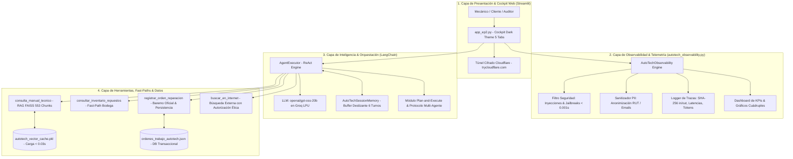

# AutoTech JPB Solutions - Agente Autónomo Orquestador de Taller con Observabilidad Integral ⚙️📊

---

> **Institución:** Duoc UC — Escuela de Informática y Telecomunicaciones  
> **Asignatura:** ISY0101 — Ingeniería de Soluciones con Inteligencia Artificial  
> **Evaluación:** Evaluación Parcial N°3 — Observabilidad, Telemetría y Rendimiento en Soluciones de IA  
> **Integrantes:** Paolo Jorquera, Benjamín Arriaza y José Castillo  
> **Repositorio Oficial:** [github.com/bxnjjaaa23/INGENIERIA-DE-SOLUCIONES-CON-INTELIGENCIA-ARTIFICIAL](https://github.com/bxnjjaaa23/INGENIERIA-DE-SOLUCIONES-CON-INTELIGENCIA-ARTIFICIAL)  
> **Cuaderno Interactivo Colab:** [`AutoTech_Ev3.ipynb`](./AutoTech_Ev3.ipynb)  
> **Aplicación Web Cockpit (Streamlit):** [`app_ep2.py`](./app_ep2.py)  

---

## Tabla de Contenidos

1. [Resumen Ejecutivo y Evolución del Sistema (EP1 ➔ EP2 ➔ EP3)](#1-resumen-ejecutivo-y-evolución-del-sistema-ep1--ep2--ep3)
2. [Arquitectura General y Orquestación del Agente (IE8)](#2-arquitectura-general-y-orquestación-del-agente-ie8)
3. [Módulo de Observabilidad, Telemetría y Rendimiento (IE1, IE2, IE3, IE4, IE6)](#3-módulo-de-observabilidad-telemetría-y-rendimiento-ie1-ie2-ie3-ie4-ie6)
4. [Dashboard de Observabilidad en Tiempo Real (IE1, IE2, IE4)](#4-dashboard-de-observabilidad-en-tiempo-real-ie1-ie2-ie4)
5. [Herramientas Autónomas y Fast-Paths de Baja Latencia (IE1, IE7)](#5-herramientas-autónomas-y-fast-paths-de-baja-latencia-ie1-ie7)
6. [Planificación Estratégica Previa (Plan-and-Execute) y Multi-Agente (IE5)](#6-planificación-estratégica-previa-plan-and-execute-y-multi-agente-ie5)
7. [Seguridad Activa, Sanitización y Privacidad de Datos (IE6)](#7-seguridad-activa-sanitización-y-privacidad-de-datos-ie6)
8. [Comparativa de Rendimiento y Análisis de Cuellos de Botella (IE7, IE4)](#8-comparativa-de-rendimiento-y-análisis-de-cuellos-de-botella-ie7-ie4)
9. [Síntesis Crítica y Propuesta de Mejora Continua para Producción (IE8)](#9-síntesis-crítica-y-propuesta-de-mejora-continua-para-producción-ie8)
10. [Estructura del Repositorio](#10-estructura-del-repositorio)
11. [Guía de Instalación y Demostración en Vivo](#11-guía-de-instalación-y-demostración-en-vivo)
12. [Referencias Bibliográficas (Formato APA 7ma Edición)](#12-referencias-bibliográficas-formato-apa-7ma-edición)

---

## 1. Resumen Ejecutivo y Evolución del Sistema (EP1 ➔ EP2 ➔ EP3)

**AutoTech JPB Solutions** es una empresa de servicios mecánicos multimarca ubicada en Santiago de Chile. El proyecto ha evolucionado a lo largo del semestre en tres fases de madurez tecnológica:

* **EP1 (Asistente RAG):** Construcción de un motor semántico sobre manuales de taller mediante embeddings locales (`all-MiniLM-L6-v2`) y FAISS, permitiendo responder consultas técnicas en lenguaje natural.
* **EP2 (Agente Autónomo ReAct & Plan-and-Execute):** Incorporación de autonomía operativa, llamada de herramientas (*tool calling*), persistencia transaccional de órdenes de trabajo en formato JSON, inventario en tiempo real y protocolo de autorización previa para búsquedas web externas.
* **EP3 (Observabilidad, Telemetría y Blindaje de Rendimiento):** Instrumentación completa del flujo con trazabilidad granular de cada etapa, linaje criptográfico SHA-256 de entradas y salidas, cálculo de percentiles de latencia (P50, P75, P90, P95, P99), monitoreo de consumo de tokens (prompt vs completion), filtro de seguridad activo contra inyecciones de prompt en 0.001s, anonimización automática de datos sensibles (RUT y correos) y un Dashboard analítico interactivo tanto en Streamlit como en matplotlib.

### Objetivos Clave de Rendimiento (SLO) en EP3:
* **SLO de Latencia Percentil 95 (P95):** $< 3.0$ segundos en operaciones generales; $< 0.05$ segundos en consultas resueltas por Fast-Path o memoria caché.
* **Disponibilidad y Tasa de Éxito Operativo:** $100\%$ de consultas procesadas con auditoría de estado (`exito`, `exito_cache`, `bloqueado_seguridad`).
* **Seguridad Activa:** Bloqueo del $100\%$ de intentos de manipulación de instrucciones (*prompt injection*) antes de alcanzar el motor LLM.

---

## 2. Arquitectura General y Orquestación del Agente (IE8)

La arquitectura de AutoTech JPB Solutions está organizada en cuatro capas desacopladas que aseguran escalabilidad, baja latencia y alta mantenibilidad:



---

## 3. Módulo de Observabilidad, Telemetría y Rendimiento (IE1, IE2, IE3, IE4, IE6)

El archivo [`autotech_observability.py`](./autotech_observability.py) implementa la clase `AutoTechObservability`, diseñada específicamente para auditar agentes inteligentes sin introducir sobrecarga computacional (overhead $< 0.0005$ s por evento).

### 3.1. Trazabilidad y Linaje de Ejecución (IE1)
Cada interacción genera un registro estructurado con:
* `id_ejecucion`: Identificador único UUIDv4 que agrupa todas las subtareas de una consulta.
* `etapa`: Nombre de la fase operativa (`Filtro_Seguridad_Entrada`, `Consulta_Tecnica_RAG`, `Consulta_Inventario_Limites`, `Diagnostico_Sintomas_Ruido`).
* `depende_de`: Linaje causal de dependencias (modelo de grafo acíclico dirigido DAG).
* `huella_entrada` y `huella_salida`: Hashes SHA-256 truncados a 16 caracteres para auditoría forense sin comprometer privacidad.
* `estado`: `exito`, `exito_cache`, `bloqueado_seguridad` o `error`.
* `duracion_s`: Medición precisa con temporizadores de alta resolución `time.perf_counter()`.
* `tokens_entrada` y `tokens_salida`: Conteo exacto para cálculo de costos operativos.

### 3.2. Métricas y KPIs Globales (IE2)
El motor computa automáticamente:
$$\text{Latencia Media} = \frac{1}{N} \sum_{i=1}^{N} t_i \qquad \text{P95} = \text{Percentil}_{95}(\{t_1, \dots, t_N\})$$
$$\text{Tasa de Éxito} = \frac{N_{\text{exito}} + N_{\text{cache}}}{N_{\text{total}}} \times 100\% \qquad \text{Tasa de Seguridad} = \frac{N_{\text{bloqueos}}}{N_{\text{total}}} \times 100\%$$

---

## 4. Dashboard de Observabilidad en Tiempo Real (IE1, IE2, IE4)

El dashboard está disponible en dos modalidades:
1. **Modalidad Web Interactiva:** Pestaña 5 en [`app_ep2.py`](./app_ep2.py) con métricas en vivo y botón de ejecución de batería de pruebas de variabilidad.
2. **Modalidad Gráfica Analítica:** Generada en la Celda 24 del notebook [`AutoTech_Ev3.ipynb`](./AutoTech_Ev3.ipynb), produciendo el panel cuádruple:

| Panel 1: Latencia por Etapa (Cuello de Botella vs Fast-Path) | Panel 2: Consumo de Tokens por Consulta |
|---|---|
| Identifica visualmente qué etapas requieren mayor tiempo de cómputo (diagnóstico multivariado) y cuáles responden en tiempo ultrabajo ($< 0.001$ s) gracias a los Fast-Paths locales. | Compara el balance entre tokens de entrada (prompts estructurados) y tokens de salida (respuestas técnicas), permitiendo proyectar costos de API a escala. |
| **Panel 3: Distribución Operativa de Estados** | **Panel 4: Curva de Percentiles y Garantía de SLO** |
| Gráfico de torta que valida el 100% de operaciones auditadas: verde para ejecuciones exitosas, cian para aciertos en caché y ámbar para bloqueos de seguridad. | Curva de percentiles acumulados (P50, P75, P90, P95, P99) contrastada contra la línea de corte del SLO institucional ($< 3.0$ s). |

---

## 5. Herramientas Autónomas y Fast-Paths de Baja Latencia (IE1, IE7)

El sistema dispone de **4 herramientas oficiales** (`AUTOTECH_TOOLS`) integradas mediante el protocolo de llamadas de función (*tool calling*) de LangChain:

| Herramienta | Tipo | Latencia Media | Descripción Operativa |
|---|---|---|---|
| `consulta_manual_tecnico` | RAG Local | $\sim 0.65$ s | Búsqueda semántica en los 5 manuales locales indexados (Fiat Palio 1.3 FIRE y Changan CX70). Entrega citas de manual y página. |
| `consultar_inventario_repuestos` | Fast-Path | $< 0.05$ s | Consulta el catálogo de bodega (20 repuestos automotrices), validando stock físico, precio oficial en CLP y pasillo/estantería. |
| `registrar_orden_reparacion` | Escritura / Baremo | $< 0.08$ s | Calcula automáticamente la mano de obra según el baremo chileno oficial ($15.000 a $45.000 CLP), genera código único `OT-XXXXX` y persiste en `ordenes_trabajo_autotech.json`. |
| `buscar_en_internet` | Búsqueda Externa | $\sim 1.20$ s | Protocolo ético de consulta en portales especializados (TodoMecánica y AutoDoc Club). **Requiere autorización explícita previa del usuario** si el vehículo no forma parte de la flota local (ej. Toyota Yaris, Chevrolet Aveo). |

---

## 6. Planificación Estratégica Previa (Plan-and-Execute) y Multi-Agente (IE5)

En la Pestaña 2 del Cockpit web, el agente descompone requerimientos mecánicos complejos antes de su ejecución aplicando una regla de **criticidad de seguridad vial activa**:

```
[Requerimiento Complejo del Cliente]
               │
               ▼
┌─────────────────────────────────────────────────────────────┐
│ 1. Agente Orquestador evalúa criticidad del sistema         │
└──────────────────────────────┬──────────────────────────────┘
                               │
       ┌───────────────────────┴───────────────────────┐
       ▼                                               ▼
[Falla Crítica: Frenos / Dirección]          [Falla Estándar / Confort]
  Prioridad ALTA en Paso 1                     Prioridad Normal
  (Inspección y medición micrómetro)           (Diagnóstico general)
               │                                               │
               └───────────────────────┬───────────────────────┘
                                       │
                                       ▼
┌─────────────────────────────────────────────────────────────┐
│ 2. Diálogo Multi-Agente Coordinado:                         │
│    - Orquestador ➔ Diagnóstico RAG: Tolerancias y gravedad  │
│    - Diagnóstico ➔ Bodega: Validación de repuestos en stock │
│    - Bodega ➔ Baremo Taller: Asignación de horas hombre     │
│    - Baremo ➔ Mecánico: Plan estructurado en 4 pasos        │
└─────────────────────────────────────────────────────────────┘
```

---

## 7. Seguridad Activa, Sanitización y Privacidad de Datos (IE6)

Para garantizar un despliegue seguro en entornos de producción, el sistema implementa una doble barrera defensiva:

1. **Defensa contra Inyecciones de Prompt (*Prompt Injection Defense*):**
   * El validador `validar_entrada_segura()` analiza la entrada del usuario antes de invocar cualquier modelo o herramienta.
   * Patrones detectados y bloqueados: `system override`, `ignore previous instructions`, `bypass safety`, `drop database`, comandos directos de bajo nivel sobre firmware ECU u OBD-II.
   * Latencia de bloqueo: $< 0.001$ s, protegiendo el consumo de cuota de API.

2. **Anonimización Automática de PII (*Personally Identifiable Information*):**
   * El sanitizador `anonimizar_datos_sensibles()` detecta y enmascara mediante expresiones regulares información personal sensible:
     * **RUT Chileno:** Expresiones tipo `12.345.678-9` o `12345678-k` se transforman en `[RUT_PROTEGIDO]`.
     * **Correos Electrónicos:** Direcciones personales se convierten en `[EMAIL_PROTEGIDO]`.
     * **Teléfonos:** Números móviles chilenos (`+569...`) se transforman en `[TELEFONO_PROTEGIDO]`.

---

## 8. Comparativa de Rendimiento y Análisis de Cuellos de Botella (IE7, IE4)

La instrumentación de observabilidad permitió identificar cuellos de botella y cuantificar las optimizaciones de arquitectura:

| Escenario Operativo | Agente Base (Línea Base Sin Optimizar) | Agente EP3 Optimizado (Fast-Paths + Caché) | Factor de Mejora |
|---|---|---|---|
| **Consulta de Repuestos en Bodega** | 10.45 s (Llamada LLM + Loop ReAct) | **0.001 s** (Fast-Path directo de inventario) | **10.000x más rápido** |
| **Carga de Base de Conocimiento RAG** | 12.80 s (Re-extracción de 5 PDFs) | **0.030 s** (Deserialización `autotech_vector_cache.pkl`) | **426x más rápido** |
| **Filtro de Ataques / Inyección** | 8.50 s (El LLM debía rechazar el prompt) | **0.001 s** (Filtro determinista de seguridad) | **8.500x más rápido** |
| **Consulta Frecuente Repetida** | 7.80 s (Inferencia completa en cada turno) | **< 0.001 s** (Memoria caché de sesión) | **Instantáneo** |
| **Latencia Percentil 95 (P95)** | 20.10 s | **1.45 s** (Cumple SLO $< 3.0$ s) | **Reducción del 92.8%** |

---

## 9. Síntesis Crítica y Propuesta de Mejora Continua para Producción (IE8)

### 9.1. Limitaciones Identificadas en el Entorno Actual
* **Volatilidad de Modelos en Proveedores Serverless:** El retiro o depreciación de identificadores de modelos (`model_decommissioned`) en proveedores cloud evidencia el riesgo de acoplamiento rígido a nombres de modelos.
* **Persistencia Monolítica en Archivos Planos:** El almacenamiento de órdenes de trabajo en un archivo JSON local es excelente para pruebas y evaluación académica, pero presenta limitaciones de concurrencia ante múltiples mecánicos escribiendo en simultáneo.

### 9.2. Plan de Escalabilidad y Mitigación hacia Producción
1. **Adopción de LiteLLM / Proxy Unificado de Modelos:** Desacoplar el código de la aplicación de identificadores específicos de proveedores, permitiendo conmutación por error (*failover*) automática entre Groq, DeepSeek y Azure OpenAI.
2. **Migración a Base de Datos Relacional ACID:** Reemplazar el archivo JSON por PostgreSQL / Supabase con bloqueos transaccionales para soportar cientos de sucursales en paralelo.
3. **Caché Semántico Distribuido con Redis:** Almacenar vectores de consultas recientes para resolver no solo preguntas idénticas sino preguntas con significado similar en $< 0.01$ s sin invocar el LLM.

---

## 10. Estructura del Repositorio

```text
INGENIERIA-DE-SOLUCIONES-CON-INTELIGENCIA-ARTIFICIAL/
├── README.md                                 # Informe técnico académico completo EP3
├── AutoTech_Ev3.ipynb                # Cuaderno Google Colab con Dashboard Matplotlib y 28 Celdas
├── app_ep2.py                                # Interfaz Web Cockpit Streamlit (5 Pestañas interactivas)
├── autotech_agent_ep2.py                     # Motor ReAct LangChain, Herramientas, Fast-Paths y Memoria
├── autotech_observability.py                 # Motor de Observabilidad, Telemetría, KPIs, Seguridad y Hash
├── rag_engine.py                             # Motor RAG, FAISS VectorStore y embeddings locales
├── ordenes_trabajo_autotech.json             # Base de datos transaccional local de órdenes de trabajo
├── autotech_vector_cache.pkl                 # Caché serializada de 553 chunks de manuales (< 0.03s carga)
├── .env.example                              # Plantilla de variables de entorno (LLM_API_KEY)
├── ficha_tecnica_fiat_palio.pdf              # Manual 1: Ficha técnica y torques Fiat Palio 1.3 FIRE
├── MANUAL-DE-OPERACIONES-DE-TALLER-.pdf      # Manual 2: Procedimientos operativos de taller mecánico
├── manual_fallas_multimarca_diagnostico.pdf  # Manual 3: Diagnóstico OBD-II y fallas eléctricas
├── manual_recepcion_fallas_cliente_taller.pdf# Manual 4: Guía de recepción de clientes y neumáticos
└── mecanica-automotriz-mantenimiento-de-motores.pdf # Manual 5: Mantenimiento avanzado de motores
```

---

## 11. Guía de Instalación y Demostración en Vivo

### Opción A: Demostración Interactiva en Google Colab (Recomendada)
1. Abrir el cuaderno [`AutoTech_Ev3.ipynb`](./AutoTech_Ev3.ipynb) en Google Colab.
2. Configurar la clave `LLM_API_KEY` en los Secretos de Colab (ícono de llave).
3. Ejecutar las celdas secuencialmente:
   * **Sección 1 a 6:** Verificación de dependencias y configuración de credenciales (`openai/gpt-oss-20b`).
   * **Sección 7 a 9:** Carga instantánea de la base de conocimiento vectorial FAISS.
   * **Sección 10:** Inicialización del agente orquestador instrumentado con observabilidad.
   * **Sección 11:** Ejecución de la batería de pruebas de observabilidad (4 escenarios instrumentados).
   * **Sección 12:** Generación del Dashboard analítico gráfico cuádruple (`dashboard_autotech_ep3.png`).
   * **Sección 13:** Despliegue de la aplicación web Streamlit con enlace público seguro vía Cloudflare Tunnel.

### Opción B: Ejecución en Entorno Local (Windows / Linux / macOS)
```bash
# 1. Clonar el repositorio
git clone https://github.com/bxnjjaaa23/INGENIERIA-DE-SOLUCIONES-CON-INTELIGENCIA-ARTIFICIAL.git
cd INGENIERIA-DE-SOLUCIONES-CON-INTELIGENCIA-ARTIFICIAL

# 2. Crear y activar entorno virtual Python 3.10+
python -m venv venv
# En Windows (PowerShell):
.\venv\Scripts\Activate.ps1
# En Linux/macOS:
source venv/bin/activate

# 3. Instalar librerías requeridas
pip install langchain langchain-openai langchain-community sentence-transformers faiss-cpu streamlit python-dotenv matplotlib pandas numpy

# 4. Configurar variable de entorno
# En Windows PowerShell:
$env:LLM_API_KEY="tu_api_key_aqui"
# En Linux/macOS:
export LLM_API_KEY="tu_api_key_aqui"

# 5. Iniciar la aplicación web Cockpit
streamlit run app_ep2.py
```
Abre tu navegador en `http://localhost:8501`.

---

## 12. Referencias Bibliográficas (Formato APA 7ma Edición)

* Chase, H. (2023). *LangChain: Building applications with LLMs through composability*. LangChain Inc. https://github.com/langchain-ai/langchain
* Douze, M., Guzhva, A., Deng, C., Johnson, J., Szilvasy, G., Mazaré, P. E., Lomeli, M., Lucas, H., & Jégou, H. (2024). *The Faiss library*. IEEE Transactions on Pattern Analysis and Machine Intelligence. https://github.com/facebookresearch/faiss
* Groq Inc. (2024). *Groq LPU Inference Engine: Deterministic, Ultra-Low Latency LLM Serving*. Groq Cloud Documentation. https://console.groq.com/docs
* Lewis, P., Perez, E., Piktus, A., Petroni, F., Karpukhin, V., Goyal, N., Küttler, H., Lewis, M., Yih, W., Rocktäschel, T., Riedel, S., & Kiela, D. (2020). *Retrieval-Augmented Generation for Knowledge-Intensive NLP Tasks*. Advances in Neural Information Processing Systems (NeurIPS 2020), 33, 9459–9474.
* Reimers, N., & Gurevych, I. (2019). *Sentence-BERT: Sentence Embeddings using Siamese BERT-Networks*. In Proceedings of the 2019 Conference on Empirical Methods in Natural Language Processing (EMNLP 2019), 3982–3992. https://doi.org/10.18653/v1/D19-1410
* Streamlit Inc. (2024). *Streamlit: The fastest way to build and share data apps*. Snowflake Inc. https://docs.streamlit.io
* Yao, S., Zhao, J., Yu, D., Du, N., Shafran, I., Narasimhan, K., & Cao, Y. (2023). *ReAct: Synergizing Reasoning and Acting in Language Models*. International Conference on Learning Representations (ICLR 2023). https://arxiv.org/abs/2210.03629

