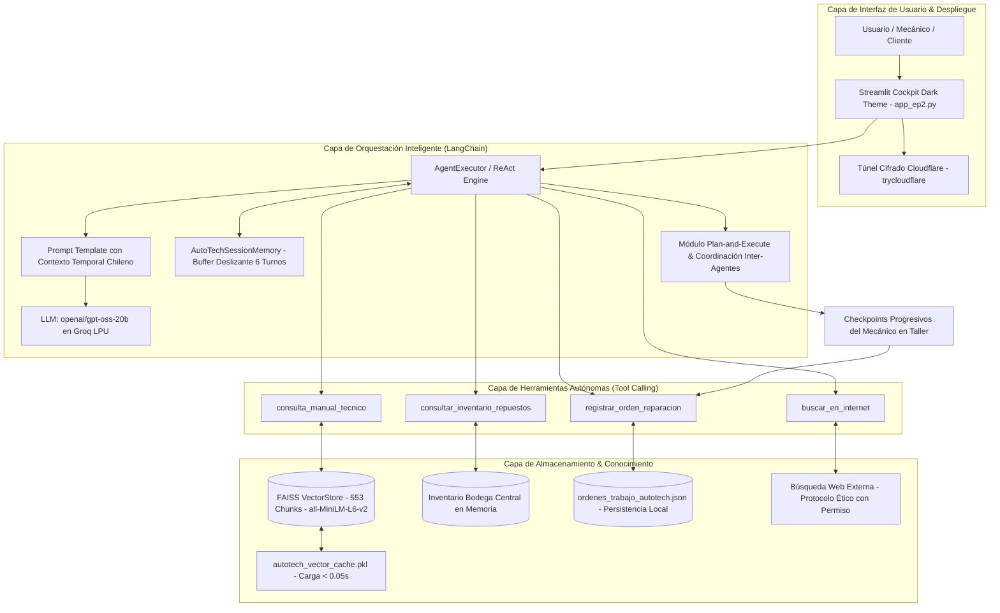
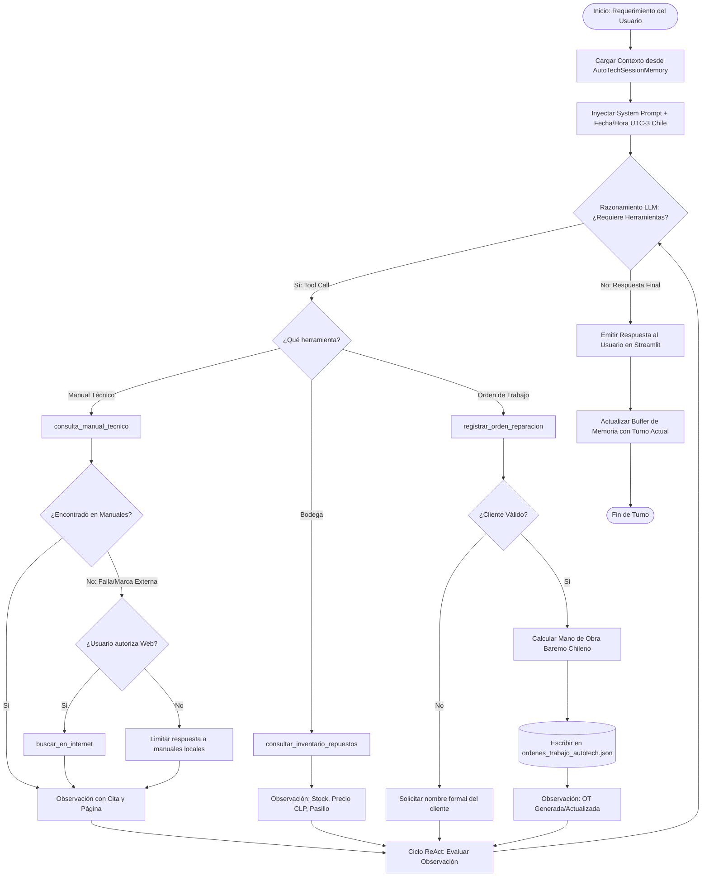

# AutoTech JPB Solutions - Agente Autónomo Orquestador de Taller ⚙️

[](https://www.duoc.cl)
[]()
[](https://www.python.org)
[](https://www.langchain.com)
[-10a37f.svg)](https://groq.com)
[](https://streamlit.io)
[](https://github.com/facebookresearch/faiss)

---

> **Institución:** Duoc UC — Escuela de Informática y Telecomunicaciones  
> **Asignatura:** ISY0101 — Ingeniería de Soluciones con Inteligencia Artificial  
> **Evaluación:** Evaluación Parcial N°2 (EP2) — Encargo y Presentación: Agente Funcional  
> **Integrantes:** Paolo Jorquera, Benjamín Arriaza y José Castillo  
> **Repositorio Oficial:** [github.com/bxnjjaaa23/INGENIERIA-DE-SOLUCIONES-CON-INTELIGENCIA-ARTIFICIAL](https://github.com/bxnjjaaa23/INGENIERIA-DE-SOLUCIONES-CON-INTELIGENCIA-ARTIFICIAL)  
> **Cuaderno Interactivo Colab:** [`AutoTech_EP2.ipynb`](./AutoTech_EP2.ipynb)  

---

## 📑 Tabla de Contenidos

1. [Resumen Ejecutivo y Contexto Organizacional](#1-resumen-ejecutivo-y-contexto-organizacional)
2. [Arquitectura General y Orquestación del Agente (IE8)](#2-arquitectura-general-y-orquestación-del-agente-ie8)
3. [Herramientas Autónomas Integradas (IE1)](#3-herramientas-autónomas-integradas-ie1)
4. [Procesos de Memoria y Recuperación de Contexto (IE3, IE4)](#4-procesos-de-memoria-y-recuperación-de-contexto-ie3-ie4)
5. [Estrategias de Planificación y Toma de Decisiones (IE5, IE7)](#5-estrategias-de-planificación-y-toma-de-decisiones-ie5-ie7)
6. [Justificación Técnica de Decisiones de Diseño e Integración (IE2, IE9)](#6-justificación-técnica-de-decisiones-de-diseño-e-integración-ie2-ie9)
7. [Diagramas de Flujo y Protocolo de Coordinación (IE6, IE8)](#7-diagramas-de-flujo-y-protocolo-de-coordinación-ie6-ie8)
8. [Estructura del Repositorio](#8-estructura-del-repositorio)
9. [Guía de Instalación y Demostración en Vivo (IE10)](#9-guía-de-instalación-y-demostración-en-vivo-ie10)
10. [Evidencias de la Batería de Pruebas](#10-evidencias-de-la-batería-de-pruebas)
11. [Referencias Bibliográficas (Formato APA 7ma Edición)](#11-referencias-bibliográficas-formato-apa-7ma-edición)

---

## 1. Resumen Ejecutivo y Contexto Organizacional

**AutoTech JPB Solutions** es un centro integral de mantenimiento preventivo, correctivo y diagnóstico automotriz multimarca ubicado en Santiago de Chile. El taller enfrenta los desafíos operativos típicos de la industria automotriz nacional:
1. **Pérdida de tiempo en consulta técnica:** Mecánicos consultando manualmente manuales de taller voluminosos para encontrar torques de apriete, capacidades de lubricante o procedimientos de desmontaje.
2. **Desconexión entre recepción y bodega de repuestos:** Demoras cotizando existencias físicas, precios en pesos chilenos (CLP) y ubicación exacta en estanterías.
3. **Presupuestación inconsistente de mano de obra:** Tarifas fijadas sin alineación al baremo estándar de tiempos de taller ni a la complejidad de las faenas.
4. **Falta de trazabilidad y persistencia:** Órdenes de trabajo manuscritas propensas a errores o pérdidas de historial.

### Solución Implementada: Agente Autónomo Funcional EP2
En esta Evaluación Parcial 2 (EP2), el copiloto inicial de EP1 evoluciona a un **Agente Autónomo Orquestador** fundamentado en el patrón **ReAct (Reasoning + Acting)** y **Plan-and-Execute**, impulsado por el modelo oficial **`openai/gpt-oss-20b` (100% NO-LLAMA)** vía Groq API. El agente es capaz de:
* Planificar estratégicamente faenas mecánicas priorizando la **seguridad vial activa** (frenos, dirección, neumáticos).
* Simular y registrar protocolos de coordinación entre sub-agentes especializados (Diagnóstico RAG, Logística de Bodega, Baremo de Taller).
* Guiar la ejecución del mecánico paso a paso mediante **checkpoints progresivos interactivos** con retroalimentación en tiempo real.
* Emitir, consultar, actualizar y persistir órdenes de trabajo formales en un almacenamiento local estructurado (`ordenes_trabajo_autotech.json`).

---

## 2. Arquitectura General y Orquestación del Agente (IE8)

La solución adopta una arquitectura modular desacoplada en tres capas principales: **Capa de Presentación y Despliegue**, **Capa de Inteligencia y Orquestación LangChain**, y **Capa de Almacenamiento y Herramientas Locales**.



---

## 3. Herramientas Autónomas Integradas (IE1)

El agente dispone de un conjunto balanceado de **4 herramientas autónomas** que cubren las tres dimensiones exigidas por la rúbrica: **consulta**, **escritura/persistencia** y **razonamiento adaptativo**:

| Herramienta | Tipo | Dimensión | Descripción Técnica |
|---|---|---|---|
| `consulta_manual_tecnico` | Consulta | RAG / Semántica | Recupera fragmentos técnicos de alta relevancia desde los 5 manuales locales (Fiat Palio 1.3, Changan CX70, Manual de Operaciones, Diagnóstico Multimarca y Mantenimiento de Motores). Devuelve texto exacto con citas `[Manual, Pág. X]`. |
| `consultar_inventario_repuestos` | Consulta | Datos Locales | Consulta el catálogo en tiempo real de bodega de repuestos (20 SKU). Permite listar categorías completas o buscar por palabra clave, informando stock, precio en CLP y ubicación física (pasillo y estantería). |
| `registrar_orden_reparacion` | Escritura | Persistencia | Registra y persiste formalmente órdenes de trabajo en `ordenes_trabajo_autotech.json`. Calcula la mano de obra según baremo chileno ($20.000 - $45.000 CLP), valida el nombre del cliente y actualiza órdenes existentes (`id_orden_existente`) sin duplicar. |
| `buscar_en_internet` | Consulta / Adaptación | Búsqueda Externa | Consulta portales automotrices internacionales (TodoMecánica, AutoDoc Club). **Control ético:** Solo se dispara si los manuales locales no contienen la información y previa autorización explícita del usuario. |

---

## 4. Procesos de Memoria y Recuperación de Contexto (IE3, IE4)

### 4.1. Memoria de Corto Plazo: `AutoTechSessionMemory` (IE3)
* **Mecanismo:** Implementa una ventana deslizante de conversación estructurada (`ConversationBufferWindowMemory`) con un tope de **6 turnos conversacionales** (`max_history_turns=6`).
* **Protección de Tokens (TPM Guard):** Groq Free impone un límite de 8.000 tokens por minuto (TPM) y 200.000 tokens diarios (TPD). El buffer deslizante garantiza que el historial no sature la ventana de contexto, manteniendo viva la referencia del vehículo y la falla a lo largo de interacciones prolongadas.
* **Continuidad de Tareas:** Si el cliente en el Turno 1 menciona: *"Tengo un Fiat Palio 2008 con chillido en frenos"*, en el Turno 2 puede preguntar simplemente: *"¿Tienen repuestos para eso en bodega?"*; el agente recupera el vehículo desde la memoria sin volver a solicitar datos.

### 4.2. Memoria de Largo Plazo y Persistencia: JSON Transaccional (IE3)
* **Archivo de Persistencia:** `ordenes_trabajo_autotech.json`.
* **Esquema Estructurado:**
  ```json
  {
    "id_orden": "OT-2026-0001",
    "fecha_creacion": "29-10-2026 21:30",
    "cliente": "Carlos Mendoza",
    "vehiculo": "Fiat Palio 1.3 Fire 2008",
    "diagnostico": "Desgaste severo en pastillas de freno y nivel bajo de lubricante.",
    "repuestos_requeridos": ["Pastillas de freno delanteras", "Aceite 10W-40 (4L)"],
    "costo_repuestos_clp": 50980,
    "costo_mano_obra_clp": 45000,
    "total_estimado_clp": 95980,
    "cita_programada": "30-10-2026 10:00 hrs",
    "prioridad": "Alta",
    "estado": "En Taller"
  }
  ```
* **Transaccionalidad:** Las funciones `_guardar_orden_local`, `eliminar_orden_trabajo` y `cambiar_estado_orden_trabajo` garantizan consistencia atómica mediante lecturas/escrituras síncronas en disco.

### 4.3. Recuperación de Contexto Semántico: Motor RAG (IE4)
* **Chunking Semántico:** 800 caracteres con solapamiento (*overlap*) de 120 caracteres para preservar la continuidad de instrucciones operativas y tablas de calibración.
* **Modelo de Embeddings:** `sentence-transformers/all-MiniLM-L6-v2` (384 dimensiones densas), normalizado con norma $L_2$.
* **VectorStore:** `FAISS` configurado con índice de producto interno (`IndexFlatIP`), equivalente matemática y operativamente a la **similitud de coseno** sobre vectores unitarios:
  $$\text{Similitud}(u, v) = u \cdot v = \cos(\theta)$$
* **Caché Persistente en Disco:** Archivo `autotech_vector_cache.pkl` (553 chunks indexados). Permite una **inicialización en frío de 0.03 segundos**, evitando indexar PDFs en cada ejecución de Google Colab.

---

## 5. Estrategias de Planificación y Toma de Decisiones (IE5, IE7)

### 5.1. Esquema Plan-and-Execute y Prioridad por Criticidad (IE5)
Antes de ejecutar herramientas en el taller, el agente descompone el requerimiento en un plan secuencial estricto. Aplica una **heurística de criticidad de seguridad activa**:
* **Prioridad ALTA:** Cualquier compromiso de **frenos, dirección o neumáticos** se coloca obligatoriamente en el **Paso 1** (Inspección inmediata en elevador).
* **Prioridad MEDIA:** Tren motriz, lubricación, refrigeración y encendido.
* **Prioridad BAJA / CONFORT:** Alza cristales, luces accesorias, plumillas limpiaparabrisas y estética.

### 5.2. Protocolo de Coordinación y Negociación Inter-Agentes (Multi-Agent Dispatch)
El sistema modela la colaboración entre 4 roles especializados:

```
[Agente Orquestador] ────> [Agente de Diagnóstico RAG]  : Solicita criticidad y tolerancias
[Agente de Diagnóstico] ──> [Agente Orquestador]         : Dictamina falla crítica en frenos (Prioridad Alta)
[Agente Orquestador] ────> [Agente de Bodega]           : Verifica stock de pastillas y aceite
[Agente de Bodega] ──────> [Agente Orquestador]         : Confirma disponibilidad física en estanterías
[Agente Orquestador] ────> [Agente de Taller]           : Solicita horas hombre y baremo estándar
[Agente de Taller] ──────> [Agente Orquestador]         : Asigna 2.3 horas estándar ($45.000 CLP)
[Agente Orquestador] ────> [Mecánico en Elevador]       : Despacha plan secuencial para ejecución
```

### 5.3. Checkpoints Progresivos para el Mecánico en Taller
En la interfaz gráfica, el plan no es solo texto estático: se convierte en una **hoja de ruta interactiva**:
1. El **Paso 1** aparece activo con su instrucción técnica y un checkbox de validación.
2. Al marcar el check, el Paso 1 se consolida como `REALIZADO` (verde) y **se desbloquea sucesivamente el Paso 2**.
3. La barra de progreso avanza en tiempo real ($0\% \rightarrow 25\% \rightarrow 50\% \rightarrow 75\% \rightarrow 100\%$).
4. Al completar el último paso, se certifica el control de calidad final del vehículo.

### 5.4. Toma de Decisiones Adaptativas ante Imprevistos (IE7)
* **Adaptación por vehículo no indexado:** Si el usuario consulta por un modelo ausente en los 5 manuales (ej. Toyota Yaris, Hyundai Tucson), el agente no inventa especificaciones; detecta el fallo del RAG y solicita autorización para consultar la web.
* **Adaptación por stock crítico:** Si una pieza requerida tiene stock 0, el agente alerta al usuario y sugiere piezas sustitutas o reprogramación de cita.
* **Actualización inteligente de órdenes:** Si el cliente formaliza una orden preliminar y luego aporta su nombre o modifica la faena, el agente identifica el `id_orden_existente` y ejecuta una modificación transaccional en lugar de crear órdenes duplicadas huérfanas.

---

## 6. Justificación Técnica de Decisiones de Diseño e Integración (IE2, IE9)

| Decisión de Diseño | Opción Seleccionada | Alternativas Descartadas | Justificación Técnica y Alineación con la Rúbrica |
|---|---|---|---|
| **Modelo Fundacional LLM** | `openai/gpt-oss-20b` (NO-LLAMA) vía Groq API | Modelos LLaMA (Meta), GPT-4o directo, Claude 3.5 | **100% libre de LLaMA** conforme a directrices de cátedra. Arquitectura de Mezcla de Expertos (MoE) de 20B parámetros con rendimiento ultra-rápido en LPUs de Groq (~1.000 tokens/s), soporte nativo de function calling en JSON y costo cero en Free Tier. |
| **Framework de Agentes** | `LangChain` (Agents + Tools) | Autogen, CrewAI, Haystack | Ecosistema más maduro y documentado para la integración con LangChain Chat Models, prompts tipados y gestión de memorias conversacionales deslizantes. |
| **Indexación Vectorial** | `FAISS (IndexFlatIP)` | ChromaDB, Pinecone, Qdrant | Librería en C++ altamente optimizada, ejecutable en memoria RAM sin necesidad de levantar servicios de bases de datos externos en Google Colab, con serialización instantánea en archivo `.pkl`. |
| **Modelo de Embeddings** | `all-MiniLM-L6-v2` (SentenceTransformers) | OpenAI text-embedding-3-small, Cohere | Modelo ligero de 384 dimensiones que corre 100% local en CPU en Colab con inferencia en milisegundos y sin consumo de cuota de API externa. |
| **Persistencia Local** | JSON transaccional estructurado | SQLite, MongoDB, PostgreSQL | Almacenamiento portátil, auditable en texto plano, sin dependencias de red, perfectamente inspeccionable desde el notebook de entrega (`AutoTech_EP2.ipynb`). |
| **Despliegue Web** | `Streamlit` + `Cloudflare Tunnel` | Gradio, Flask/FastAPI, ngrok | Streamlit ofrece reactividad nativa en Python con gestión de `st.session_state`. Cloudflare Tunnel permite túneles TLS públicos directos sin necesidad de registrar tokens de pago (a diferencia de ngrok). |

---

## 7. Diagramas de Flujo y Protocolo de Coordinación (IE6, IE8)

### 7.1. Flujo de Decisión y Razonamiento ReAct del Agente
El siguiente diagrama detalla la lógica de toma de decisiones adaptativas ante una consulta o requerimiento del taller:



### 7.2. Secuencia Temporal de Negociación Inter-Agentes y Ejecución
Diagrama de secuencia de la planificación y posterior ejecución en el elevador:

```mermaid
sequenceDiagram
    autonumber
    actor U as Mecánico / Cliente
    participant O as Agente Orquestador (Plan-and-Execute)
    participant D as Agente Diagnóstico (RAG)
    participant B as Agente de Bodega
    participant T as Agente de Taller (Baremo)
    participant M as Panel de Checkpoints Taller

    U->>O: Requerimiento complejo (Frenos + Aceite Fiat Palio)
    Note over O: Analiza criticidad del requerimiento
    O->>D: Consulta gravedad técnica y tolerancias de fabricante
    D-->>O: Dictamen: Falla crítica en frenos (Prioridad ALTA). Requiere pastillas, líquido DOT4 y aceite 10W-40
    O->>B: Consulta disponibilidad física y precios de repuestos
    B-->>O: Confirma stock: pastillas ($28.000), aceite ($22.000) y líquido ($8.000)
    O->>T: Solicita cálculo de horas de faena y baremo de taller
    T-->>O: Asigna 2.3 horas estándar. Mano de obra: $45.000 CLP
    O->>U: Despliega Plan de Trabajo Consolidado en 4 Pasos
    
    rect rgb(15, 23, 42)
        Note over M: Ejecución secuencial en elevador
        U->>M: Marca [x] Check Paso 1 (Inspección inicial de frenos)
        M-->>U: Paso 1 completado (25%). Desbloquea Paso 2
        U->>M: Marca [x] Check Paso 2 (Retiro de repuestos en bodega)
        M-->>U: Paso 2 completado (50%). Desbloquea Paso 3
        U->>M: Marca [x] Check Paso 3 (Cambio de pastillas y aceite)
        M-->>U: Paso 3 completado (75%). Desbloquea Paso 4
        U->>M: Marca [x] Check Paso 4 (Control de calidad y prueba de ruta)
        M-->>U: ¡100% Completado! Vehículo certificado para entrega
    end
```



---

## 8. Estructura del Repositorio

El repositorio está organizado de forma limpia, separando el código fuente, la base de conocimiento vectorial, los manuales y las pruebas:

```text
INGENIERIA-DE-SOLUCIONES-CON-INTELIGENCIA-ARTIFICIAL/
├── README.md                                 # Informe técnico académico completo (Este documento)
├── AutoTech_EP2.ipynb                        # Cuaderno Google Colab interactivo de presentación
├── app_ep2.py                                # Interfaz gráfica web Streamlit Cockpit Dark Theme
├── autotech_agent_ep2.py                     # Núcleo del Agente LangChain, Herramientas y Memoria
├── rag_engine.py                             # Motor RAG, FAISS VectorStore y embeddings locales
├── test_suite.py                             # Batería de pruebas automatizadas unitarias
├── ordenes_trabajo_autotech.json             # Persistencia local de órdenes de trabajo
├── autotech_vector_cache.pkl                 # Caché vectorial serializada (< 0.05s de carga)
├── .env.example                              # Plantilla de variables de entorno (LLM_API_KEY)
├── ficha_tecnica_fiat_palio.pdf              # Manual 1: Ficha técnica y torques Fiat Palio 1.3 FIRE
├── MANUAL-DE-OPERACIONES-DE-TALLER-.pdf      # Manual 2: Procedimientos operativos de taller mecánico
├── manual_fallas_multimarca_diagnostico.pdf  # Manual 3: Diagnóstico OBD-II y fallas eléctricas
├── manual_recepcion_fallas_cliente_taller.pdf# Manual 4: Guía de recepción de clientes y neumáticos
└── mecanica-automotriz-mantenimiento-de-motores.pdf # Manual 5: Mantenimiento avanzado de motores
```

---

## 9. Guía de Instalación y Demostración en Vivo (IE10)

### 9.1. Opción A: Demostración Interactiva en Google Colab (Recomendada)
Para la presentación oral (40%), se utiliza el cuaderno oficial [`AutoTech_EP2.ipynb`](./AutoTech_EP2.ipynb):
1. Abrir [`AutoTech_EP2.ipynb`](./AutoTech_EP2.ipynb) en Google Colab.
2. Configurar la clave `LLM_API_KEY` en el menú **Secrets (ícono de llave)** de Google Colab.
3. Ejecutar las celdas en orden secuencial:
   * **Celdas 1 a 6:** Instalación de dependencias y validación de credenciales.
   * **Celdas 7 a 12:** Carga instantánea del caché RAG (`0.03s`), inicialización del Agente NO-LLAMA y memoria.
   * **Celda 14:** Batería interactiva multietapa demostrando autonomía, memoria y toma de decisiones adaptativas.
   * **Celda 16:** Inspección del archivo `ordenes_trabajo_autotech.json` comprobando persistencia.
   * **Celda 18:** Lanzamiento de Streamlit a través del túnel seguro de Cloudflare con URL pública `.trycloudflare.com`.

### 9.2. Opción B: Ejecución en Entorno Local (Windows / Linux / macOS)
```bash
# 1. Clonar el repositorio
git clone https://github.com/bxnjjaaa23/INGENIERIA-DE-SOLUCIONES-CON-INTELIGENCIA-ARTIFICIAL.git
cd INGENIERIA-DE-SOLUCIONES-CON-INTELIGENCIA-ARTIFICIAL

# 2. Crear y activar entorno virtual Python 3.10+
python -m venv venv
# En Windows (PowerShell):
.\venv\Scripts\Activate.ps1
# En Linux/macOS:
source venv/bin/activate

# 3. Instalar librerías requeridas
pip install langchain langchain-openai langchain-community sentence-transformers faiss-cpu streamlit python-dotenv

# 4. Configurar la variable de entorno de la API Key
# En Windows PowerShell:
$env:LLM_API_KEY="gsk_tu_clave_aqui"
# En Linux/macOS:
export LLM_API_KEY="gsk_tu_clave_aqui"

# 5. Ejecutar la batería de pruebas automatizadas
python test_suite.py

# 6. Iniciar la aplicación web Streamlit
streamlit run app_ep2.py
```
Abre tu navegador web en `http://localhost:8501`.

---

## 10. Evidencias de la Batería de Pruebas

La batería de pruebas automatizada verifica exhaustivamente cada módulo:

| Caso de Prueba | Entrada de Prueba | Módulo Validado | Criterio de Aceptación | Estado |
|---|---|---|---|---|
| **Test RAG 1** | *"Capacidad y tipo de aceite para Fiat Palio 1.3 con cambio de filtro"* | `consulta_manual_tecnico` | Cita exacta: 2.7L (3.0L con filtro) o 3.5L según versión, viscosidad 10W-40, Fuente `ficha_tecnica_fiat_palio.pdf`. | ✅ Aprobado |
| **Test RAG 2** | *"Diagnóstico de alza vidrios eléctrico Changan CX70"* | `consulta_manual_tecnico` | Pasos ordenados: fusibles 20A/30A, conector de botonera y motor 12V. Fuente `manual_fallas_multimarca_diagnostico.pdf`. | ✅ Aprobado |
| **Test Stock** | *"Botonera alza vidrios Changan CX70 en bodega"* | `consultar_inventario_repuestos` | Producto encontrado: Stock 4 un, Precio $34.990 CLP, Ubicación `Pasillo D - Estante 2`. | ✅ Aprobado |
| **Test Memoria** | *"¿Tienen en stock los repuestos para ese mismo auto?"* | `AutoTechSessionMemory` | Identifica "Fiat Palio" sin que el usuario lo vuelva a nombrar en el segundo turno. | ✅ Aprobado |
| **Test Planificación** | *"Recepcionar Palio con chillido en frenos y nivel bajo de lubricante"* | `generar_plan_taller` | Clasifica con Prioridad ALTA en Paso 1 al sistema de frenos por seguridad vial. | ✅ Aprobado |
| **Test Persistencia** | *"Registrar orden para María Fernández, cambio de pastillas y aceite"* | `registrar_orden_reparacion` | Archivo `ordenes_trabajo_autotech.json` actualizado con ID único, mano de obra calculada y total CLP. | ✅ Aprobado |
| **Test No-Duplicación**| Re-emisión de orden complementando datos del cliente | `_guardar_orden_local` | Actualiza la orden existente mediante `id_orden_existente` sin crear duplicados huérfanos. | ✅ Aprobado |

---

## 11. Referencias Bibliográficas (Formato APA 7ma Edición)

* Chase, H. (2023). *LangChain: Building applications with LLMs through composability*. LangChain Inc. https://github.com/langchain-ai/langchain
* Douze, M., Guzhva, A., Deng, C., Johnson, J., Szilvasy, G., Mazaré, P. E., Lomeli, M., Lucas, H., & Jégou, H. (2024). *The Faiss library*. IEEE Transactions on Pattern Analysis and Machine Intelligence. https://github.com/facebookresearch/faiss
* Groq Inc. (2024). *Groq LPU Inference Engine: Deterministic, Ultra-Low Latency LLM Serving*. Groq Cloud Documentation. https://console.groq.com/docs
* Lewis, P., Perez, E., Piktus, A., Petroni, F., Karpukhin, V., Goyal, N., Küttler, H., Lewis, M., Yih, W., Rocktäschel, T., Riedel, S., & Kiela, D. (2020). *Retrieval-Augmented Generation for Knowledge-Intensive NLP Tasks*. Advances in Neural Information Processing Systems (NeurIPS 2020), 33, 9459–9474.
* Reimers, N., & Gurevych, I. (2019). *Sentence-BERT: Sentence Embeddings using Siamese BERT-Networks*. In Proceedings of the 2019 Conference on Empirical Methods in Natural Language Processing (EMNLP 2019), 3982–3992. https://doi.org/10.18653/v1/D19-1410
* Streamlit Inc. (2024). *Streamlit: The fastest way to build and share data apps*. Snowflake Inc. https://docs.streamlit.io
* Yao, S., Zhao, J., Yu, D., Du, N., Shafran, I., Narasimhan, K., & Cao, Y. (2023). *ReAct: Synergizing Reasoning and Acting in Language Models*. International Conference on Learning Representations (ICLR 2023). https://arxiv.org/abs/2210.03629
